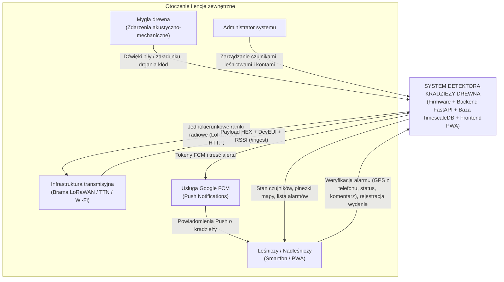
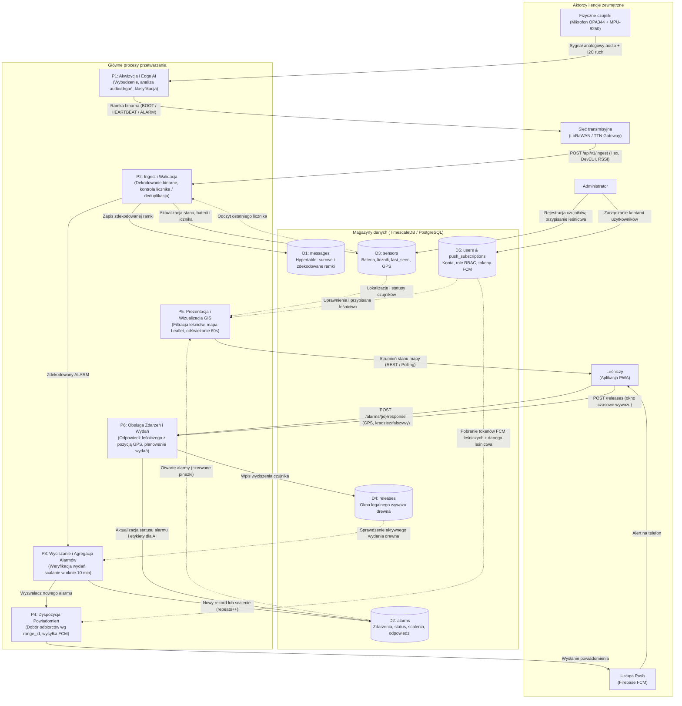
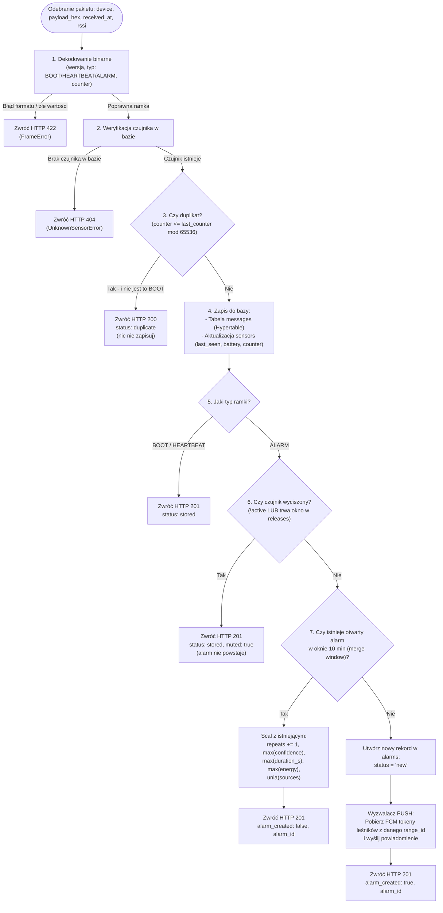

# Diagramy przepływu danych (Data Flow Diagrams – DFD)

System detekcji kradzieży drewna (IoT AGH).

---

## 1. DFD Poziom 0 – Diagram kontekstowy

---

## 2. DFD Poziom 1 – Diagram procesów systemowych

---

## 3. DFD Poziom 2 – Logika procesu odbioru ramki (`/ingest`) i alarmu

---

## 4. Tabela strumieni danych

| Identyfikator | Przepływ danych | Typ / Format danych | Zawartość / Pola |
|---|---|---|---|
| **S1** | Sygnał fizyczny $\to$ Urządzenie | Analogowy / I2C | Amplituda i widmo akustyczne (mikrofon), przyspieszenie 3D (MPU-9250). |
| **S2** | Urządzenie $\to$ Sieć $\to$ Backend | Pakiet binarny / JSON | `device` (DevEUI), `payload_hex` (np. `11002A...`), `rssi`, `received_at`. |
| **S3** | Payload $\to$ Dekoder | Struktura bajtowa | Nagłówek (wersja: 4 bity, typ: 4 bity, licznik: 2 B) + ciało specyficzne dla typu. |
| **S4** | Dekoder $\to$ `messages` | Rekord bazy (JSONB) | `sensor_id`, `msg_type`, `counter`, `decoded` (JSON: bateria, confidence, sources, duration, energy). |
| **S5** | Backend $\to$ `sensors` | Relacyjny UPDATE | `battery_pct`, `last_seen`, `last_counter`. |
| **S6** | Ingest $\to$ `alarms` | Relacyjny INSERT/UPDATE | `started_at`, `confidence`, `sources` (`microphone`, `vibration`), `repeats`, `status` (`new`). |
| **S7** | Backend $\to$ Firebase $\to$ Telefon | JSON / Push payload | Tytuł alertu, nazwa składu drewna, leśnictwo, czas, `alarm_id`. |
| **S8** | Backend $\to$ Frontend PWA | JSON (REST API) | Lista czujników (`lat`, `lon`, kolor stanu), lista alarmów. |
| **S9** | Leśniczy $\to$ Backend | JSON (`POST /alarms/{id}/response`) | `result` (`theft` / `false_alarm`), `comment`, `lat`, `lon` (pozycja GPS ze smartfona). |
| **S10** | Leśniczy $\to$ Backend | JSON (`POST /releases`) | `sensor_id`, `starts_at`, `ends_at`, `carrier`, `log_count`, `comment`. |
